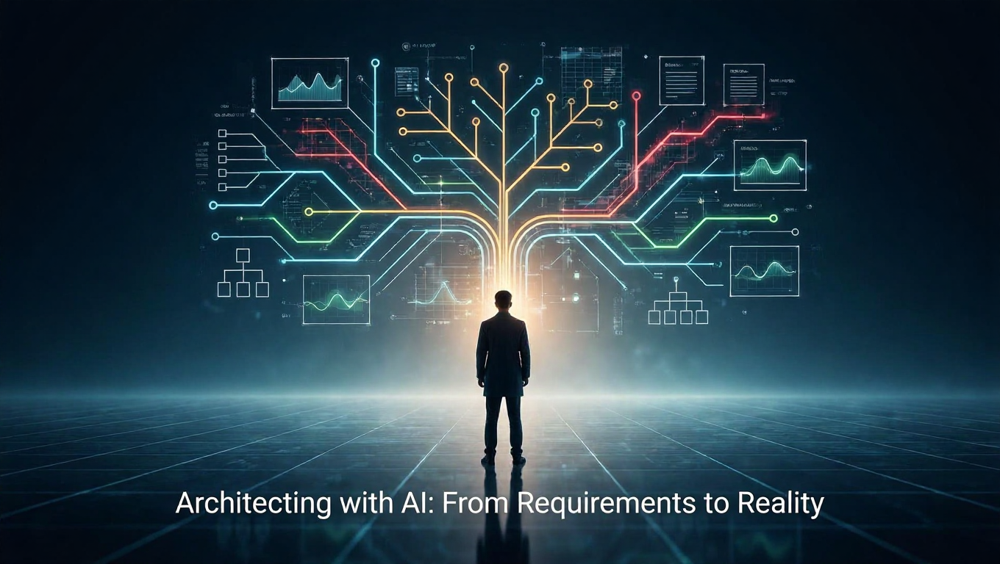

# Architecting With AI: From Requirements to Reality

 🗣️Talk 🟢 Intermediate

## Abstract

This session focuses on employing AI as a partner to architects throughout the architectural process. Rather than replacing architects, AI expands their exploration of possibilities, specifically in clarifying ambiguous requirements, generating and evaluating design options, and assessing assumptions to avoid costly errors.

We will walk through an end-to-end example demonstrating how AI can highlight hidden constraints, uncover risks early, and broaden the problem space to support architectural decisions. The session will also address where AI falls short (hallucinating APIs, inventing constraints, shallow reasoning) and offer targeted techniques for directing AI toward useful, constraint-aware analysis and transparent trade-off justifications.

The session concludes with a practical review workflow. You will learn to check and correct AI's mistakes, enforce your requirements, and formalize AI-generated concepts into lasting architectural documents such as ADRs and decision logs. You will leave with an actionable workflow for collaborating responsibly with AI throughout the architectural process.

   

## Learning Objectives

- **Use AI to interrogate requirements and surface hidden constraints.** Learn how to turn vague inputs into architecturally meaningful clarity.
- **Co-design architectures with AI using a structured trade-off workflow.** Generate and compare options quickly while forcing AI to reason rather than regurgitate.
- **Convert AI output into durable, human-owned decisions.** Detect hallucinations, enforce constraints, and refactor AI ideas into governance-aligned artifacts.

## Presentations

| Event | Location | Date | Time | Room | Downloads |
|-------|:--------:|-----:|-----:|-----:|----------:|
| [The Cloud & AI Summit 2026](https://www.cloudandaisummit.com/) | St. Louis, MO | 2026-09-30 to 2026-10-02 | TBA | TBA | Available Afterwards |
| [Beer City Code 2026](https://www.beercitycode.com/) | Grand Rapids, MI | 2026-08-15 | TBA | TBA | Available Afterwards |

## Resources
There are no additional resources for this presentation.

Email [chadgreen@chadgreen.com](mailto:chadgreen@chadgreen.com?subject=Presentation%20Request:%20Presentation%20Title) to have Chad present this session at your event.